# PowerShell: Windows File Management, Help Desk Ticketing & Backup Verification


## Project Overview

This project documents my first hands-on PowerShell lab, where I learned how to navigate Windows directories, create and manage files, troubleshoot commands, and verify file backups using PowerShell 7.

The purpose of this lab was to develop foundational PowerShell skills that are useful in IT Help Desk and Desktop Support positions.

I also completed a simulated Help Desk practical exam where I created a support ticket, organized documentation, and created a backup.

This README provides a step-by-step walkthrough so other beginners can recreate the lab.

## Lab Environment

| Component | Configuration |
|---|---|
| Operating System | Windows 11 |
| PowerShell Version | 7.7.0 |
| Terminal | Windows Terminal |
| Lab Type | Beginner PowerShell / IT Help Desk |
| Virtualization | Not required |
| Experience Level | Beginner |

## Skills Demonstrated

- Installing and verifying PowerShell 7
- Navigating Windows directories using commands
- Creating folders and text files
- Writing, reading, and appending file contents
- Copying, moving, and renaming files
- Discovering PowerShell commands and documentation
- Troubleshooting incorrect paths and command errors
- Creating and verifying file backups
- Using SHA-256 hashes to verify file integrity

---

# Installing and Configuring PowerShell

### Objective

Install PowerShell 7 and verify that the correct version is running.

### Step 1: Install PowerShell

Open Windows Terminal or Windows PowerShell and execute:

```powershell
winget install --id Microsoft.PowerShell --source winget
```

**Command explanation:**

- `winget` — Windows Package Manager.
- `install` — Instructs Windows to install software.
- `--id` — Identifies the application package.
- `Microsoft.PowerShell` — The PowerShell package identifier.
- `--source winget` — Specifies the package repository.

The installation completed successfully.
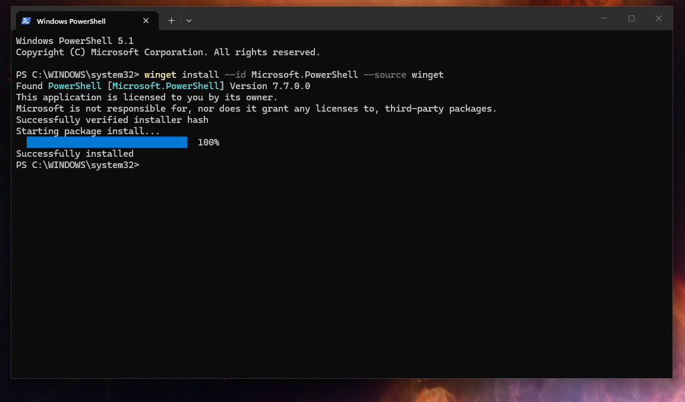

### Step 2: Launch PowerShell 7

```powershell
pwsh
```

This launches PowerShell 7.

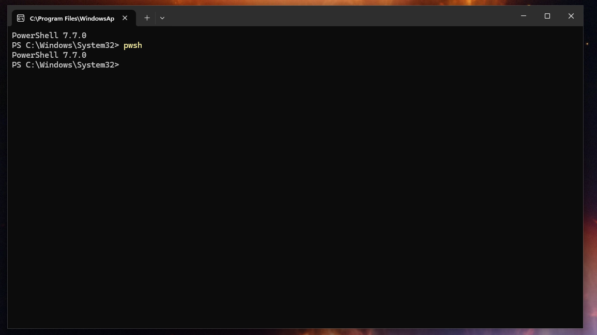

### Step 3: Verify the version

```powershell
$PSVersionTable
```

This displays information about the PowerShell environment.

**My result:**

- PSVersion: 7.7.0
- PSEdition: Core
- Platform: Win32NT

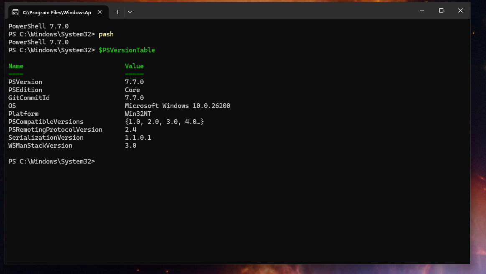
---

# Navigating Windows Directories

### Objective

Learn how to locate directories, change the current directory, and view folder contents.

### Step 1: Identify the current directory

```powershell
Get-Location
```
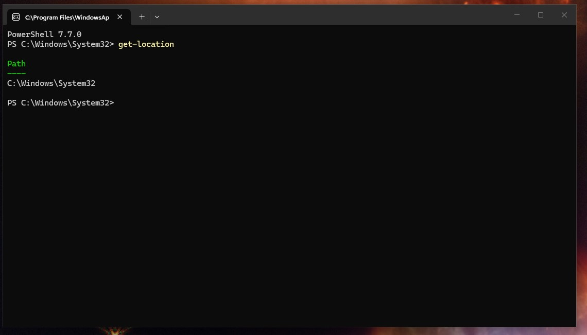

This command displays the current working directory.

My initial location was:

```text
C:\Windows\System32
```

### Step 2: Navigate to Documents

```powershell
Set-Location "$HOME\Documents"
```

`Set-Location` changes the current directory.

`$HOME` is a built-in variable containing the user's profile path.

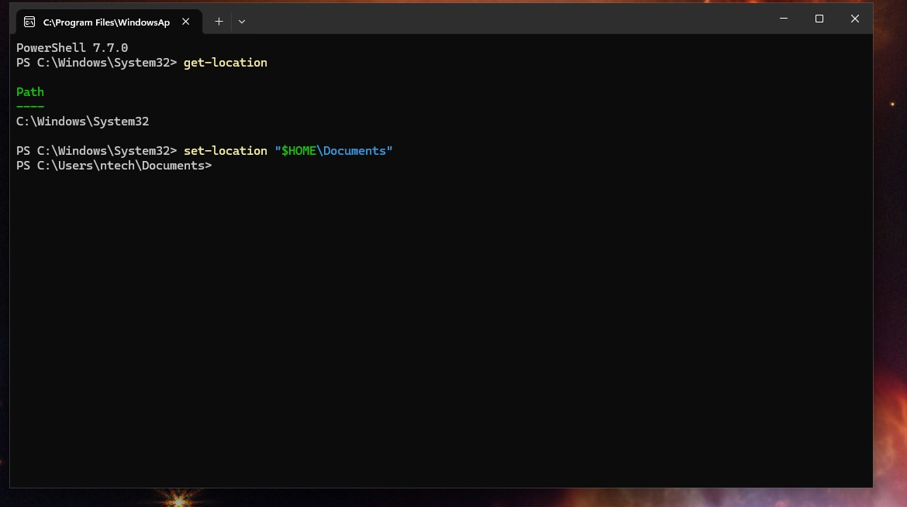

### Step 3: Verify the location

```powershell
Get-Location
```
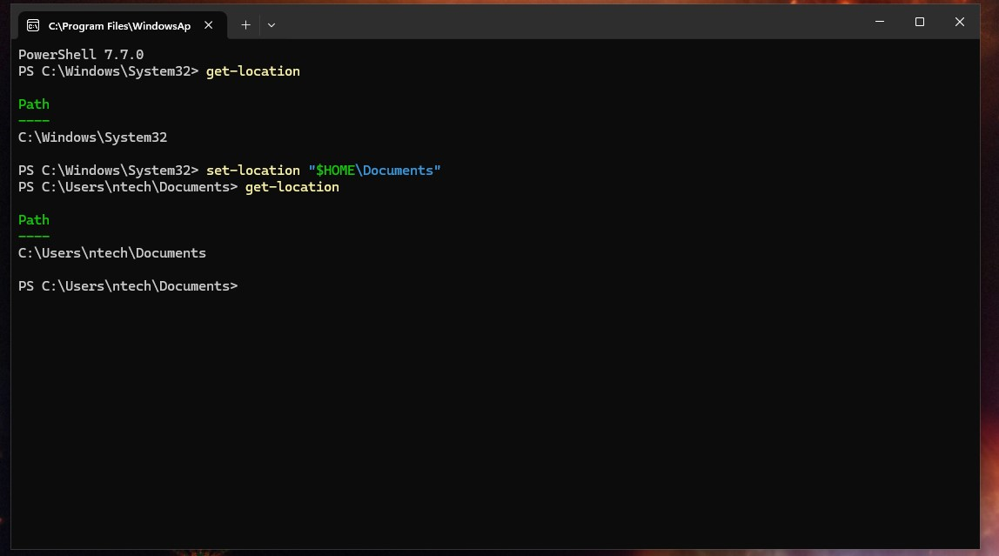

### Step 4: View folder contents

```powershell
Get-ChildItem
```

This command displays files and folders inside the current directory.

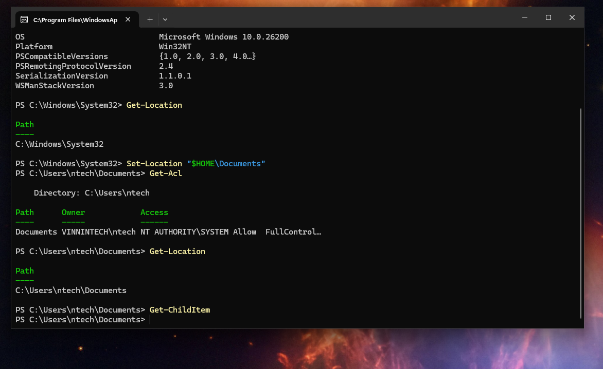

**What I learned:** PowerShell commands often use a Verb-Noun naming structure. For example, `Get-Location` retrieves the current location, while `Set-Location` changes it.


---

# Creating Files and Folders

### Objective

Create a workspace and learn how to write information into text files.

### Step 1: Create a lab folder

From Documents:

```powershell
New-Item -Name "PowerShell Labs" -ItemType Directory
```
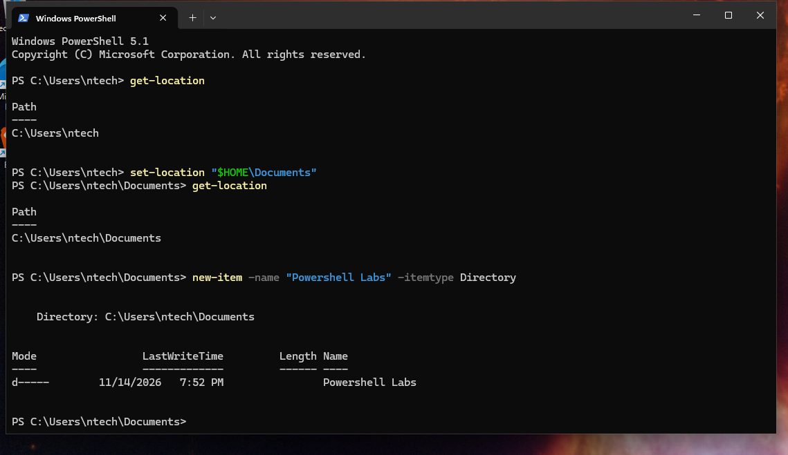

`New-Item` creates a new item, and `-ItemType Directory` specifies that the item should be a folder.

### Step 2: Enter the folder

```powershell
Set-Location "PowerShell Labs"
```

### Step 3: Create a text file

```powershell
New-Item -Name "Lab1 Notes.txt" -ItemType File
```
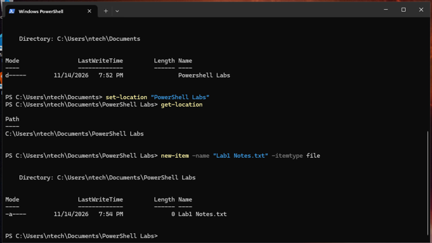

The `File` item type creates an empty file.

### Step 4: Write information into the file

```powershell
Set-Content -Path "Lab1 Notes.txt" -Value "My first PowerShell lab is in progress."
```

`Set-Content` writes information to a file, replacing existing contents.

### Step 5: Read the file

```powershell
Get-Content -Path "Lab1 Notes.txt"
```

**Expected output:**

```text
My first PowerShell lab is in progress.
```

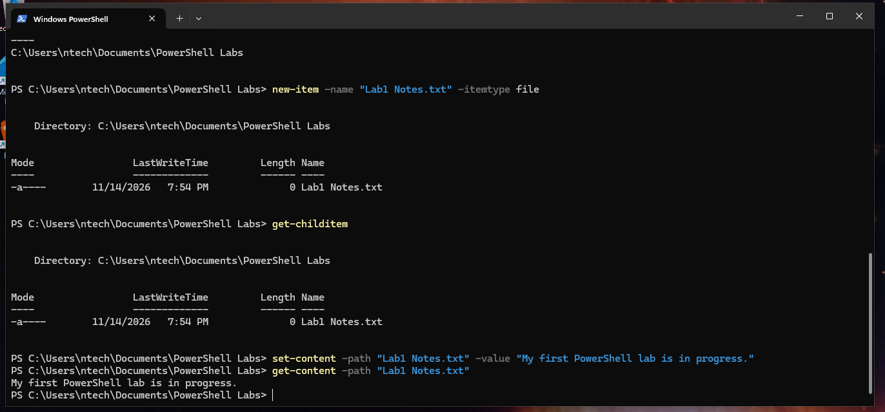

---

# Managing Files and Creating Backups

### Objective

Practice copying, renaming, and moving files.

### Step 1: Copy a file

```powershell
Copy-Item -Path "Lab1 Notes.txt" -Destination "Lab1 Notes Backup.txt"
```

`Copy-Item` creates a duplicate while preserving the original file.

### Step 2: Rename the backup

```powershell
Rename-Item -Path "Lab1 Notes Backup.txt" -NewName "HelpDesk Backup.txt"
```
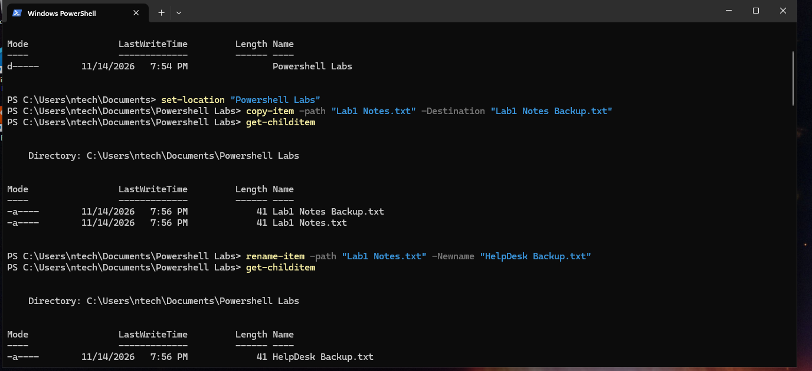

`Rename-Item` changes the file's name without modifying its contents.

### Step 3: Create a backup folder

```powershell
New-Item -Name "Backups" -ItemType Directory
```
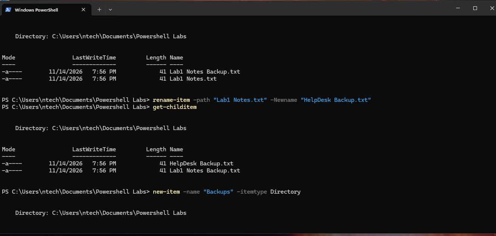

### Step 4: Move the backup

```powershell
Move-Item -Path "HelpDesk Backup.txt" -Destination ".\Backups\"
```
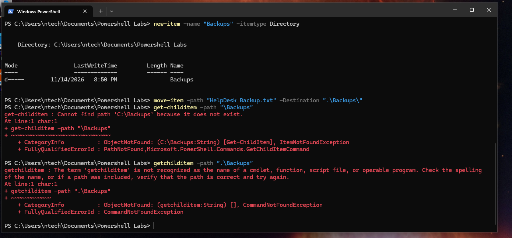

`Move-Item` relocates the file to the destination.

### Step 5: Verify the backup

```powershell
Get-ChildItem -Path ".\Backups"
```


**What I learned:** `Copy-Item` preserves the original, while `Move-Item` relocates an item. These commands can be used to organize troubleshooting logs and backup files.


---

# Discovering Commands and Troubleshooting

### Objective

Learn how to find commands, access documentation, and troubleshoot errors.

### Step 1: Discover commands

```powershell
Get-Command -Name "*Item*"
```

The `*` character is a wildcard that matches zero or more characters.

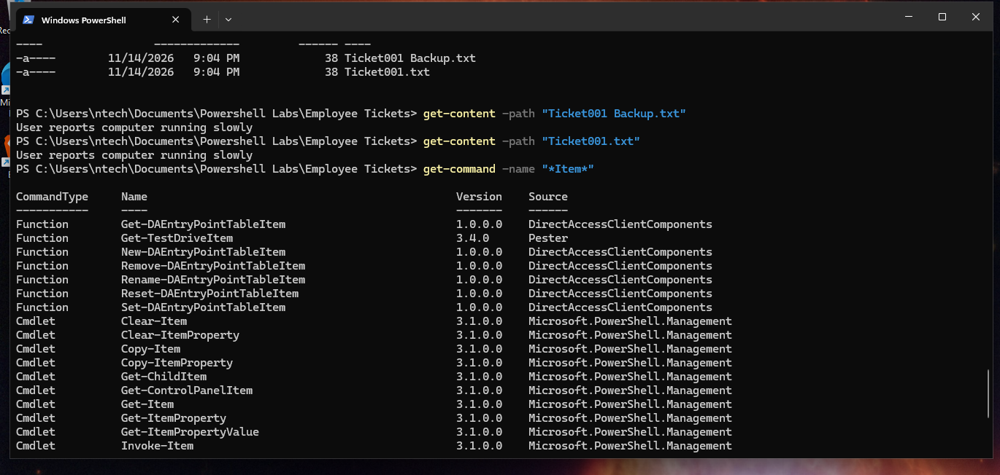

This command finds available commands with `Item` in their names.

### Step 2: Access PowerShell help

```powershell
Get-Help Copy-Item
```

!{}(screenshots/4Command-Discovery-and-Troubleshooting/PowerShell-Screenshot-27.png)

To view examples:

```powershell
Get-Help Copy-Item -Examples
```
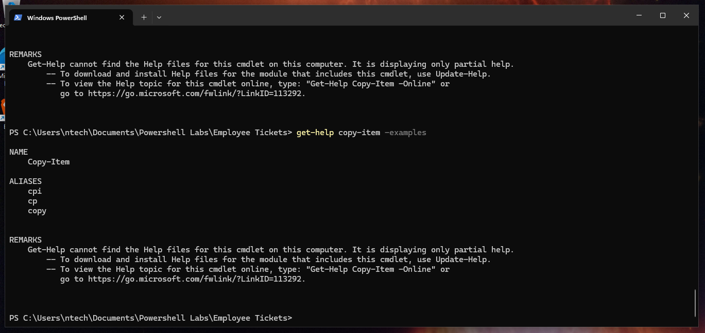

### Troubleshooting: Missing Help Documentation

When I attempted to access command examples, PowerShell initially displayed incomplete documentation.

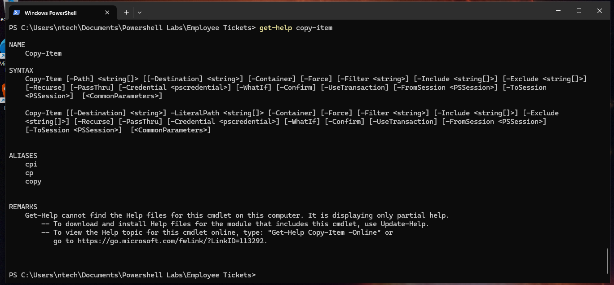

I attempted:

```powershell
Update-Help -UICulture en-US -ErrorAction Continue
```
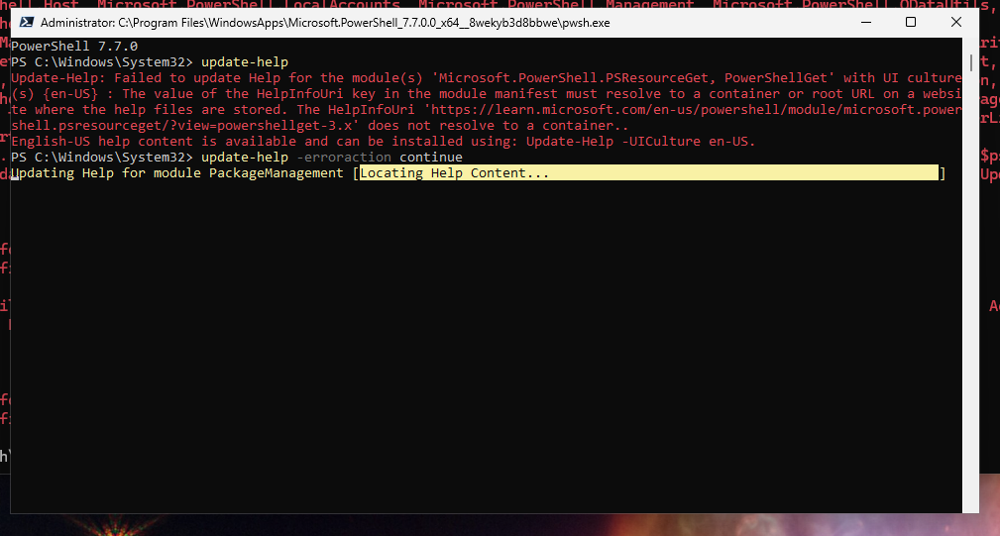

Some modules continued reporting help-documentation errors. However, I was eventually able to display examples for `Copy-Item`.

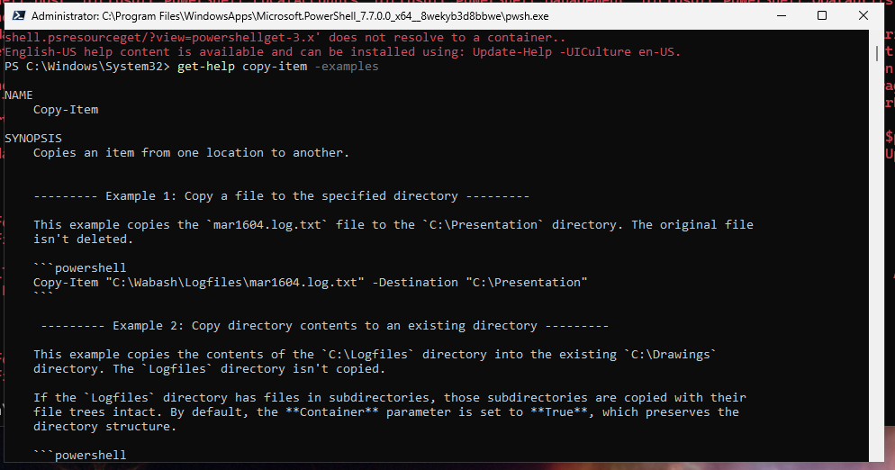

An alternative is:

```powershell
Get-Help Copy-Item -Online
```

### Troubleshooting: Incorrect Folder Paths

I initially used:

```powershell
Get-ChildItem -Path "\Backups"
```

PowerShell couldn't find the folder.

I learned that a leading backslash starts from the root of the current drive.

The corrected command was:

```powershell
Get-ChildItem -Path ".\Backups"
```

The `.` refers to the current directory.

### Verify folder existence

```powershell
Test-Path ".\Backups"
Test-Path "\Backups"
```

**My results:**

```text
True
False
```

This demonstrated the difference between relative and root-relative paths.

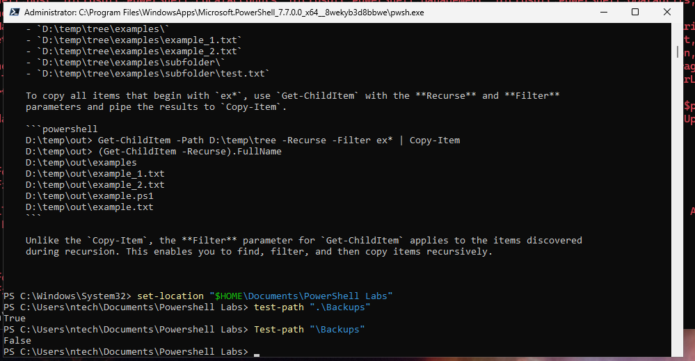


# Troubleshooting Summary

| Issue | Resolution |
|---|---|
| Incorrect folder path | Verified the current directory using `Get-Location` |
| Folder not found | Corrected the relative path |
| Misspelled PowerShell command | Checked command spelling and punctuation |
| Missing Help documentation | Investigated `Update-Help` errors and checked available examples |
| Unable to navigate from Tickets to Backups | Used `..` to reference the parent directory |
| Backup location uncertain | Used `Get-ChildItem -Recurse` and `Test-Path` |

---

# Project Outcome

I successfully completed my first beginner PowerShell lab and final practical assessment.

Through this project, I gained hands-on experience managing Windows files and directories, documenting simulated Help Desk tickets, creating backups, and troubleshooting common PowerShell errors.

One of the most important lessons I learned was to verify my current directory and confirm the results of each command rather than assuming it completed successfully.

This project strengthened my foundational PowerShell knowledge and prepared me for more advanced IT support scripting and automation tasks.
